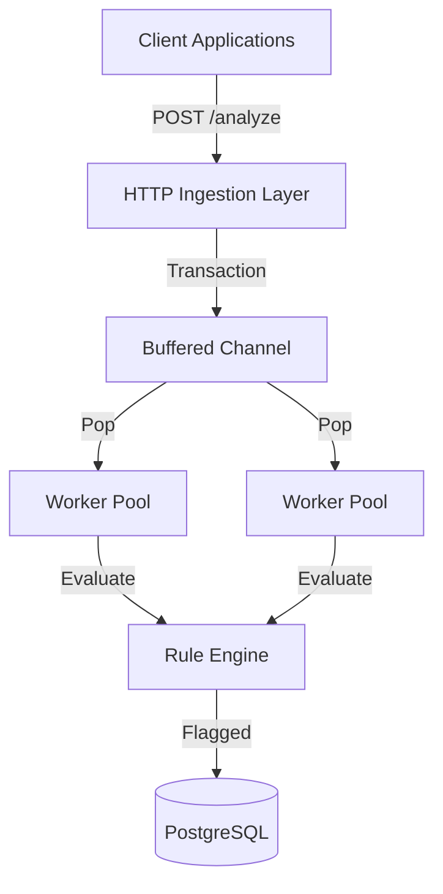
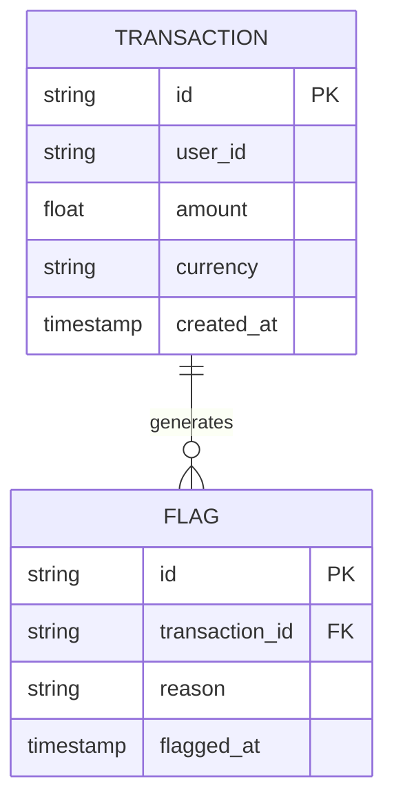
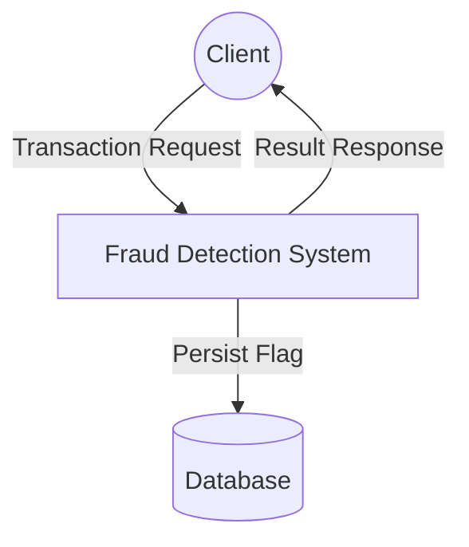
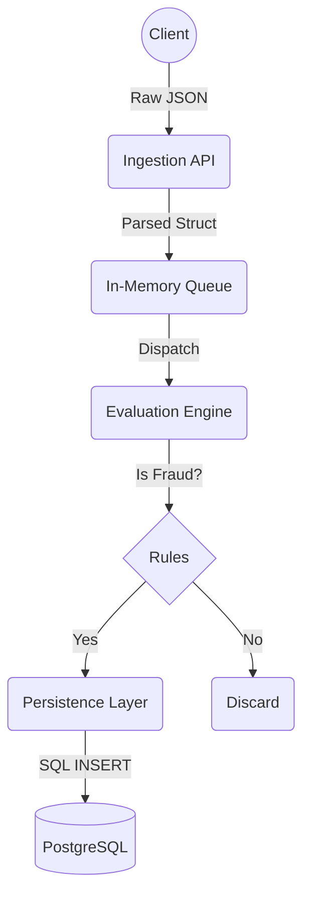
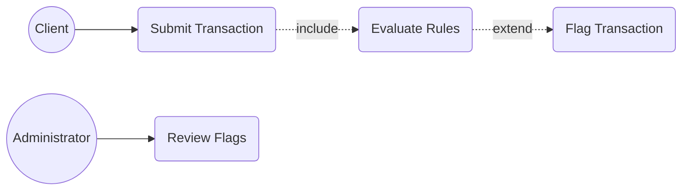
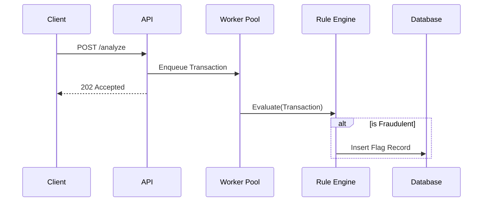

# Real-Time Fraud Detection Engine

## The Problem
Modern financial systems require ultra-low-latency processing to detect and prevent fraudulent transactions before they settle. Traditional batch-processing pipelines are too slow, and generic rule engines introduce unacceptable overhead. There is a need for a highly concurrent, memory-optimized engine capable of evaluating complex heuristics across thousands of transactions per second while maintaining strict persistence for flagged anomalies.

## The Architecture
This system is architected as a high-throughput, concurrent event processor written in Go. It utilizes Go's goroutines and channels to implement a worker-pool pattern, decoupling HTTP ingestion from rule evaluation. Ingested transactions are routed to an in-memory evaluation engine where deterministic rules are applied. Flagged transactions are asynchronously persisted to a PostgreSQL database using an optimized connection pool, ensuring the critical ingestion path remains unblocked. The entire stack is containerized for seamless deployment.

## Tech Stack
* Programming Language: Go (Golang)
* Database: PostgreSQL
* Infrastructure: Docker, Docker Compose
* API Layer: standard `net/http`

## Local Setup
1. Clone the repository:
   ```bash
   git clone https://github.com/kholipha-ahmmad-al-amin/fraud-detection-engine.git
   cd fraud-detection-engine
   ```
2. Start the infrastructure (PostgreSQL):
   ```bash
   docker-compose up -d db
   ```
3. Run the engine:
   ```bash
   go run cmd/server/main.go
   ```
4. Send a test transaction:
   ```bash
   curl -X POST http://localhost:8080/analyze -d '{"id": "tx-123", "amount": 15000, "user_id": "usr-99", "currency": "USD"}'
   ```

## System Documentation

### System Architecture Diagram


### Entity Relationship Diagram (ERD)


### Data Flow Diagram (Level 0)


### Data Flow Diagram (Level 1)


### Use Case Diagram


### Sequence Diagram


Developed by Kholipha Ahmmad Al-Amin
Founder and CEO, EquiSaaS BD | Principal Consultant, AR IT Consultancy
Expertise: Full Stack Enterprise Architecture & AI Engineering
GitHub: https://github.com/kholipha-ahmmad-al-amin
LinkedIn: https://www.linkedin.com/in/kholipha-ahmmad-al-amin
Portfolio: https://kholipha-ahmmad-al-amin.equisaas-bd.com
Email: kholifaahmadalamin@gmail.com
